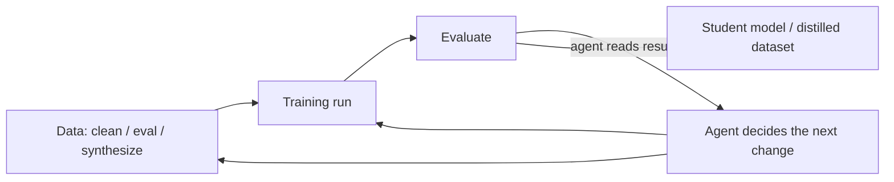

# Awesome Agentic ML

**Agents that build models — automated data engineering, training runs,
distillation, and synthetic data. The agent-era successor to AutoML.**

English · [简体中文](README.zh-CN.md)

🤖 **Daily arXiv radar:** [docs/radar.md](docs/radar.md) — auto-refreshed every day.

---

## The scope: what gets improved

This is one of three sibling lists, split by **the thing that gets improved**:

| Product | List |
|---|---|
| **Code** (software engineering an agent can verify against tests) | [awesome-self-improving-coding-agents](https://github.com/vicfei/awesome-self-improving-coding-agents) |
| **Skills & organizations** (how firms absorb agents) | [awesome-ai-native](https://github.com/vicfei/awesome-ai-native) |
| **Models & data** — this list | **awesome-agentic-ml** |

In scope: systems where the deliverable is a **model or a dataset** — agents running training experiments, cleaning and evaluating data, distilling teachers into students, generating synthetic training data. When an agent edits `train.py` so the *val loss* drops, that's here; when it edits application code so *tests* pass, that's the sibling list.

Out of scope: classic MLOps (deploying/monitoring models — see the incumbents in [Related lists](#related-lists)), and pre-agent AutoML papers (NAS era — same).

## The loop

## Start here

| # | Work | Why start here |
|---|---|---|
| 1 | [autoresearch](https://github.com/karpathy/autoresearch) — Karpathy | The whole thesis in three files: the agent edits training code overnight, the human writes `program.md`, a fixed 5-minute budget keeps experiments comparable. |
| 2 | [MLE-bench](https://arxiv.org/abs/2410.07095) | The yardstick for this entire list: can an agent do ML engineering end-to-end (Kaggle-style)? |
| 3 | [Agent-R1](https://github.com/AgentR1/Agent-R1) | The training substrate: step-level MDP RL for tool-using agents. |
| 4 | [EasyDistill](https://github.com/modelscope/easydistill) | The data view: black-box teachers → SFT/DPO datasets, including agent-trajectory distillation. |

## Systems

### Autonomous experimentation

| System | What it automates |
|---|---|
| [autoresearch](https://github.com/karpathy/autoresearch) — Karpathy | Single-GPU overnight training experiments (~100/night): agent edits `train.py`, keeps what improves val_bpb, discards the rest. |
| [Deep Researcher Agent](https://github.com/Xiangyue-Zhang/auto-deep-researcher-24x7) · [paper](https://arxiv.org/abs/2604.05854) | 24/7 DL experimentation with explicit discipline — narrow search, forced verification, human control. |
| [karpathy](https://github.com/K-Dense-AI/karpathy) (the agent, not the person) | An agentic Machine Learning Engineer — the job title as a system. |
| [Optim-Agent](https://github.com/Optim-Agent/optim-agent) | LLM agents as your hyperparameter optimizer — the AutoML core loop, agent-first. |
| [autogluon-assistant](https://github.com/autogluon/autogluon-assistant) | Multi-agent system on top of AutoGluon for end-to-end multimodal AutoML. |

### Training frameworks and post-training

| System | What it is |
|---|---|
| [Agent-R1](https://github.com/AgentR1/Agent-R1) · [paper](https://arxiv.org/abs/2511.14460) | Agentic RL with step-level MDP transitions; Online Policy Distillation branch bridges RL training and distillation. |
| [NeoHorse](https://github.com/TokenRhythm/NeoHorse) · [report](https://arxiv.org/abs/2609.08183) | Open-weight 4B/9B agent models built via agentic post-training with a routing harness; the Jev decision primitives. |

### Data agents

| System | What it is |
|---|---|
| [dash](https://github.com/agno-agi/dash) | A self-learning data agent built with systems-engineering primitives. |

### Distillation toolchains

"Distillation" now means three different things; this list tracks the agent-facing end of all three:

| System | Which distillation |
|---|---|
| [torchdistill](https://github.com/yoshitomo-matsubara/torchdistill) | Classical KD (logits/features) — 26+ methods, maintained since 2019; the elder statesman. |
| [EasyDistill](https://github.com/modelscope/easydistill) | LLM-era data distillation: compose generate/eval/filter/rewrite operators into SFT/DPO pipelines, agent trajectories included. |
| [distilly](https://github.com/titanwings/distilly) | Cognitive distillation: people → skills. (The org-side story lives in [awesome-ai-native](https://github.com/vicfei/awesome-ai-native).) |

## Papers: the self-training recipes

The training loop's fuel is data the model (or an agent) generates itself:

| Year | Work | What it established |
|---|---|---|
| 2022 | [STaR](https://arxiv.org/abs/2203.14465) | Bootstrap reasoning by training on self-generated rationales that lead to correct answers. |
| 2022 | [Self-Instruct](https://arxiv.org/abs/2212.10560) | The model writes its own instruction-tuning data — seed of every synthetic-data loop. |
| 2023 | [ReST^EM](https://arxiv.org/abs/2312.06585) | Generate → filter → fine-tune, scaled past human data. |
| 2024 | [SPIN](https://arxiv.org/abs/2401.01335) | Self-play fine-tuning: beat your own past iterations. |
| 2024 | [Self-Rewarding Language Models](https://arxiv.org/abs/2401.10020) | The model judges and revises its own outputs to create its next preference data. |
| 2025 | [Absolute Zero](https://arxiv.org/abs/2505.03335) | Zero external data: propose tasks, verify with a code executor, train on the result. |
| 2025 | [SEAL](https://arxiv.org/abs/2506.10943) | The model edits its own fine-tuning data — self-modification at the training-recipe level. |

**The counterweight:** [model collapse](https://doi.org/10.1038/s41586-024-07566-y) (Nature) — recursive training on self-generated data degrades distribution tails. Every pipeline above should be read against this result.

## Benchmarks

| Benchmark | Measures | Link |
|---|---|---|
| **MLE-bench** | End-to-end ML engineering, Kaggle-style | [paper](https://arxiv.org/abs/2410.07095) · [code](https://github.com/openai/mle-bench) |

## Open problems

1. **Data agents lack a benchmark.** MLE-bench covers training runs; nobody has the "SWE-bench of data engineering" (clean → evaluate → pipeline agents on real warehouses).
2. **Experiment comparability at scale.** autoresearch's fixed-budget trick works on one GPU; there is no standard for comparing agent-run experiments across platforms.
3. **License clarity.** Several fast-moving systems in this space ship non-OSI licenses (source-available, NOASSERTION) — check before commercial use.
4. **Distillation governance.** When agents distill teachers into students (or colleagues into skills), provenance and permission trails don't exist yet.

## 🤖 Radar

`docs/radar.md` is regenerated **daily** by [`scripts/radar.py`](scripts/radar.py) (GitHub Actions, [workflow](.github/workflows/radar.yml)) from arXiv new-submission listings, keyword-filtered for agentic-ML / data-agent topics. Precision-first keywords — tune via PR.

## Related lists

- [awesome-self-improving-coding-agents](https://github.com/vicfei/awesome-self-improving-coding-agents) — sibling: agents improving code (SWE-verifiable work)
- [awesome-ai-native](https://github.com/vicfei/awesome-ai-native) — sibling: the organizational layer
- [KaiWU5/Awesome-AI4AI](https://github.com/KaiWU5/Awesome-AI4AI) — the paper-survey companion to this space (223 papers)
- [wasiahmad/Awesome-LLM-Synthetic-Data](https://github.com/wasiahmad/Awesome-LLM-Synthetic-Data) — synthetic-data generation reading list
- [hibayesian/awesome-automl-papers](https://github.com/hibayesian/awesome-automl-papers) — the pre-agent AutoML canon
- [EthicalML/awesome-production-machine-learning](https://github.com/EthicalML/awesome-production-machine-learning) — the production/MLOps incumbents

## Contributing

PRs welcome — see [CONTRIBUTING.md](CONTRIBUTING.md). The bar: primary-source links, one line on **what it automates**, and respect for the product boundary (code → sibling list; org → sibling list).

## License

[CC0 1.0](LICENSE) — public domain.
