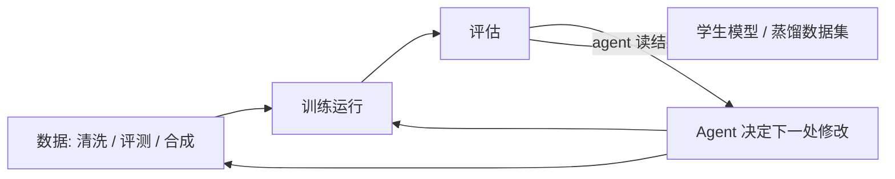

# Awesome Agentic ML

**造模型的 Agent —— 数据工程、训练运行、蒸馏与合成数据的自动化。
AutoML 的 agent 时代继任者。**

[English](README.md) · 简体中文

🤖 **每日 arXiv 雷达：** [docs/radar.md](docs/radar.md) —— 每天自动刷新。

---

## 收录范围：改进的目标物是什么

本列表是三姊妹列表之一，按**被改进的目标物**分界：

| 产品 | 列表 |
|---|---|
| **代码**（可用测试验证的软件工程工作） | [awesome-self-improving-coding-agents](https://github.com/vicfei/awesome-self-improving-coding-agents) |
| **技能与组织**（企业如何消化 agent） | [awesome-ai-native](https://github.com/vicfei/awesome-ai-native) |
| **模型与数据** —— 本列表 | **awesome-agentic-ml** |

收录：交付物是**模型或数据集**的系统——跑训练实验的 agent、清洗与评测数据的 agent、把教师蒸馏进学生的 agent、生成合成训练数据的 agent。当 agent 修改 `train.py` 使 *val loss* 下降，属于这里；当它修改业务代码让*测试*通过，属于姊妹列表。

不收：经典 MLOps（模型的部署与监控——见[相邻列表](#相邻列表)中在位者），以及 agent 时代之前的 AutoML 论文（NAS 时代——同样）。

## 回路

## 从这里读起

| # | 工作 | 为什么 |
|---|---|---|
| 1 | [autoresearch](https://github.com/karpathy/autoresearch) —— Karpathy | 三个文件写尽全部命题：agent 通宵改训练代码，人写 `program.md`，固定 5 分钟预算保证实验可比。 |
| 2 | [MLE-bench](https://arxiv.org/abs/2410.07095) | 整个列表的尺子：agent 能否端到端做机器学习工程（Kaggle 式）？ |
| 3 | [Agent-R1](https://github.com/AgentR1/Agent-R1) | 训练底座：面向工具调用智能体的步级 MDP 强化学习。 |
| 4 | [EasyDistill](https://github.com/modelscope/easydistill) | 数据视角：黑盒教师 → SFT/DPO 数据集，含 agent 轨迹蒸馏。 |

## 系统

### 自动化实验

| 系统 | 自动化了什么 |
|---|---|
| [autoresearch](https://github.com/karpathy/autoresearch) —— Karpathy | 单 GPU 通宵训练实验（一晚约 100 个）：agent 改 `train.py`，留下使 val_bpb 改进的，丢弃其余。 |
| [Deep Researcher Agent](https://github.com/Xiangyue-Zhang/auto-deep-researcher-24x7) · [论文](https://arxiv.org/abs/2604.05854) | 24/7 深度学习实验，纪律为纲——收窄搜索、强制验证、人类掌控。 |
| [karpathy](https://github.com/K-Dense-AI/karpathy)（agent，不是本人） | 一个"智能体机器学习工程师"——把职位做成了系统。 |
| [Optim-Agent](https://github.com/Optim-Agent/optim-agent) | LLM agent 当你的超参优化器——AutoML 核心回路的 agent 化重做。 |
| [autogluon-assistant](https://github.com/autogluon/autogluon-assistant) | AutoGluon 之上的多智能体系统，端到端多模态 AutoML。 |

### 训练框架与后训练

| 系统 | 是什么 |
|---|---|
| [Agent-R1](https://github.com/AgentR1/Agent-R1) · [论文](https://arxiv.org/abs/2511.14460) | 步级 MDP 转移的智能体 RL；在线策略蒸馏（OPD）分支打通 RL 训练与蒸馏。 |
| [NeoHorse](https://github.com/TokenRhythm/NeoHorse) · [报告](https://arxiv.org/abs/2609.08183) | 以 routing harness 做 agentic 后训练得到的开源 4B/9B agent 模型；Jev 决策原语。 |

### 数据智能体

| 系统 | 是什么 |
|---|---|
| [dash](https://github.com/agno-agi/dash) | 用系统工程原语构建的自学习数据智能体。 |

### 蒸馏工具链

"蒸馏"如今有三种含义；本列表追踪其中面向 agent 的一端：

| 系统 | 哪种蒸馏 |
|---|---|
| [torchdistill](https://github.com/yoshitomo-matsubara/torchdistill) | 经典知识蒸馏（logits/特征）——26+ 方法，2019 年维护至今的长者。 |
| [EasyDistill](https://github.com/modelscope/easydistill) | LLM 时代的数据蒸馏：生成/评估/过滤/改写算子组合成 SFT/DPO 流水线，含 agent 轨迹。 |
| [distilly](https://github.com/titanwings/distilly) | 认知蒸馏：人 → 技能。（组织侧的故事在 [awesome-ai-native](https://github.com/vicfei/awesome-ai-native)。） |

## 论文：自训练配方

训练回路的燃料是模型（或 agent）自己生成的数据：

| 年份 | 工作 | 确立了什么 |
|---|---|---|
| 2022 | [STaR](https://arxiv.org/abs/2203.14465) | 用导向正确答案的自生成推理路径做自举训练。 |
| 2022 | [Self-Instruct](https://arxiv.org/abs/2212.10560) | 模型自己写指令微调数据——一切合成数据回路的种子。 |
| 2023 | [ReST^EM](https://arxiv.org/abs/2312.06585) | 生成→过滤→微调，规模化到超越人类数据。 |
| 2024 | [SPIN](https://arxiv.org/abs/2401.01335) | 自博弈微调：击败自己过去的迭代。 |
| 2024 | [Self-Rewarding Language Models](https://arxiv.org/abs/2401.10020) | 模型评判并修订自己的输出，生成下一版的偏好数据。 |
| 2025 | [Absolute Zero](https://arxiv.org/abs/2505.03335) | 零外部数据：自己出题、用代码执行器验证、以结果训练。 |
| 2025 | [SEAL](https://arxiv.org/abs/2506.10943) | 模型编辑自己的微调数据——训练配方层面的自我修改。 |

**对冲读物：**[模型坍缩](https://doi.org/10.1038/s41586-024-07566-y)（Nature）——在自生成数据上递归训练会退化分布尾部。上面每条流水线都应对照这篇阅读。

## 基准

| 基准 | 度量什么 | 链接 |
|---|---|---|
| **MLE-bench** | 端到端机器学习工程，Kaggle 式 | [论文](https://arxiv.org/abs/2410.07095) · [代码](https://github.com/openai/mle-bench) |

## 悬而未决的问题

1. **数据智能体缺基准。** MLE-bench 覆盖训练运行；还没有"数据工程界的 SWE-bench"（在真实数仓上评测 清洗→评测→流水线 智能体）。
2. **实验可比性缺标准。** autoresearch 的固定预算技巧在单 GPU 上有效；跨平台比较 agent 主导的实验尚无标准。
3. **许可证不明。** 本领域多个快速迭代的系统采用非 OSI 许可（source-available、NOASSERTION）——商用前务必核查。
4. **蒸馏治理。** 当 agent 把教师蒸馏进学生（或把同事蒸馏成技能）时，来源与授权链条尚不存在。

## 🤖 雷达

`docs/radar.md` 由 [`scripts/radar.py`](scripts/radar.py)（GitHub Actions，[workflow](.github/workflows/radar.yml)）基于 arXiv 新提交列表**每天**重建，按 agentic-ML / 数据智能体主题做关键词过滤。关键词精度优先——欢迎提 PR 调整。

## 相邻列表

- [awesome-self-improving-coding-agents](https://github.com/vicfei/awesome-self-improving-coding-agents) —— 姊妹列表：改进代码的 agent（SWE 可验证的工作）
- [awesome-ai-native](https://github.com/vicfei/awesome-ai-native) —— 姊妹列表：组织层
- [KaiWU5/Awesome-AI4AI](https://github.com/KaiWU5/Awesome-AI4AI) —— 本领域的论文综述配套（223 篇）
- [wasiahmad/Awesome-LLM-Synthetic-Data](https://github.com/wasiahmad/Awesome-LLM-Synthetic-Data) —— 合成数据生成阅读清单
- [hibayesian/awesome-automl-papers](https://github.com/hibayesian/awesome-automl-papers) —— agent 时代之前的 AutoML 典籍
- [EthicalML/awesome-production-machine-learning](https://github.com/EthicalML/awesome-production-machine-learning) —— 生产/MLOps 在位者

## 贡献

欢迎 PR —— 见 [CONTRIBUTING.md](CONTRIBUTING.md)。门槛：一手来源链接、一句话说明**自动化了什么**、遵守产品分界（代码 → 姊妹列表；组织 → 姊妹列表）。

## 许可

[CC0 1.0](LICENSE) —— 公共领域。
